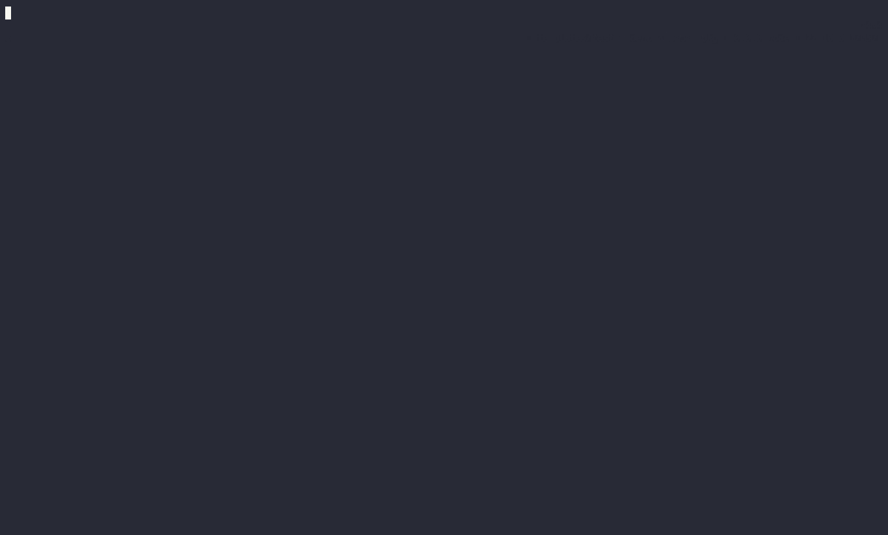

<div align="center">
  
  <h1>Templates</h1>
  <p><b>Opinionated monorepo scaffolding templates for cargo-generate and kickstart</b></p>
  <p>
    Every template ships with linting, formatting, typechecking, tests, CI workflows<br />
    and release automation already wired together, so a generated project is<br />
    production-ready from the first commit.
  </p>

  <!-- Toolchain badges -->
  <p>
    <a href="#quality-gates"></a>
    
    
    
    
    
    
  </p>

  <p>
    <a href="#about-the-project">About</a>
    &middot;
    <a href="#templates">Templates</a>
    &middot;
    <a href="#getting-started">Getting started</a>
    &middot;
    <a href="#development-workspace">Development</a>
    &middot;
    <a href="#quality-gates">Quality gates</a>
    &middot;
    <a href="#continuous-integration-and-delivery">CI/CD</a>
  </p>
</div>

<hr />

## About the project

This repository is a monorepo of project templates. Each package under `packages/` is a
scaffold that is rendered into a brand new repository by one of two generators:

- [cargo-generate](https://github.com/cargo-generate/cargo-generate) renders templates
  driven by a `cargo-generate.toml` manifest, with interactive placeholders and Rhai
  pre/post generation hooks.
- [kickstart](https://github.com/Keats/kickstart) renders templates driven by a
  `template.toml` manifest, with validated variables, conditional prompts and shell
  post-generation hooks.

The templates follow a naming convention that makes their scope obvious at a glance:

| Prefix | Meaning |
| ------ | ------- |
| `m-`   | Standalone monorepo scaffold: generates a complete repository |
| `mm-`  | Monorepo member scaffold: generates a drop-in package for an existing pnpm + Turbo workspace |



## Templates

| Template | Generator | Kind | Description |
| -------- | --------- | ---- | ----------- |
| [m-deno](packages/m-deno) | cargo-generate | `m-` | Deno monorepo with pnpm workspace members, changesets versioning and Rhai generation hooks |
| [m-rsbuild-plugin](packages/m-rsbuild-plugin) | kickstart | `m-` | Standalone monorepo for developing an rsbuild plugin, with playground and integration tests |
| [mm-rslib](packages/mm-rslib) | kickstart | `mm-` | Library member built with Rslib, including a files-only JSON/YAML variant |
| [mm-vite-react](packages/mm-vite-react) | cargo-generate | `mm-` | Vite + React application member |
| [mm-native-lynx-app](packages/mm-native-lynx-app) | kickstart | `mm-` | Native [Lynx](https://lynxjs.org/) application member with rspeedy, Android (Kotlin) and iOS (Swift/ObjC) shells |
| [mm-nuxt-better-auth-drizzle](packages/mm-nuxt-better-auth-drizzle) | kickstart | `mm-` | Fullstack Nuxt member with better-auth authentication and Drizzle ORM targeting SQLite or PostgreSQL |

Every generated project inherits the same engineering baseline: Biome for linting and
formatting, TypeScript strict mode, Vitest with a 100 percent coverage threshold,
cspell spellchecking, Turbo task orchestration, Renovate dependency automation and
preconfigured GitHub workflows.

## Getting started

### Prerequisites

| Tool | Version | Required for |
| ---- | ------- | ------------ |
| [Node.js](https://nodejs.org/) | 24 or newer | Running the workspace tooling |
| [pnpm](https://pnpm.io/) | 12 or newer | Installing and scripting (Corepack picks the pinned version automatically) |
| [cargo-generate](https://github.com/cargo-generate/cargo-generate) | 0.22 or newer | Rendering the cargo-generate templates |
| [kickstart](https://github.com/Keats/kickstart) | latest | Rendering the kickstart templates |

### Generating a project

Clone this repository, pick a template from the table above and run the matching
generator from the repository root:

```bash
git clone https://github.com/elcoosp/templates.git
cd templates

# cargo-generate based templates (m-deno, mm-vite-react)
cargo generate --path packages/m-deno/template

# kickstart based templates (m-rsbuild-plugin, mm-rslib, mm-native-lynx-app, mm-nuxt-better-auth-drizzle)
kickstart packages/mm-rslib
```

Each generator prompts for project variables (name, organization, description and
template specific options). Every prompt has a sensible default, so
`cargo generate --path ... --name my-proj` or `kickstart --no-input packages/mm-rslib`
produces a working project without interaction.

### Smoke tests for generated output

The `tests/` directory holds template values files used to render the templates into
throwaway projects and run their full pipelines, for example:

```bash
cargo generate -p packages/m-deno/template --name test-m-deno \
  --template-values-file tests/m-deno.toml --allow-commands
```

## Development workspace

This repository is itself a pnpm + Turborepo workspace. Package sources are small
Rslib builds whose tests assert the integrity of the template folders they ship.

```text
.
├── packages/        # One package per template (source + template payload)
│   └── m-deno/
│       ├── src/     # Workspace package source
│       ├── tests/   # Vitest suites validating the template folder
│       └── template/ # The payload rendered by the generator
├── tests/           # Cross-cutting template values files for smoke tests
└── turbo.json       # Task graph: build, check, typecheck, test, coverage
```

### Scripts

| Command | Description |
| ------- | ----------- |
| `pnpm boot` | Install, build, check and test the whole workspace in one shot |
| `pnpm build` | Build every package through Turbo |
| `pnpm check` | Run Biome in CI mode across all packages |
| `pnpm fmt` / `pnpm fmt:check` | Apply or verify Biome formatting |
| `pnpm typecheck` | Run `tsc --noEmit` in every package |
| `pnpm test` | Run all Vitest suites |
| `pnpm test:cov` | Run tests with coverage and enforce the 100 percent threshold |
| `pnpm spellcheck` | Spellcheck the repository with cspell |
| `pnpm changeset` | Record a changeset for versioned packages |

## Quality gates

All gates run in CI on every push and pull request, and all of them must pass:

| Gate | Tool | Guarantee |
| ---- | ---- | --------- |
| Formatting | Biome | Stable, canonical formatting |
| Linting | Biome (recommended preset) | No lint diagnostics |
| Typechecking | TypeScript `tsc --noEmit` | No type errors |
| Unit tests | Vitest | All suites green |
| Coverage | Vitest + V8 provider | Statements, branches, functions and lines at exactly 100 percent |
| Spellcheck | cspell | No misspelled words in tracked files |
| Build | Rslib via Turbo | Every package compiles with zero warnings |

The coverage threshold is enforced in each package `vitest.config.ts`
(`statements`, `branches`, `functions` and `lines` all pinned to `100`), so a drop in
coverage fails the build instead of a dashboard.

## Continuous integration and delivery

- **CI** (`.github/workflows/ci.yml`): a least-privilege, single-job pipeline that
  checks out the repository without persisting credentials, installs dependencies
  with a frozen lockfile and runs every quality gate above. Runs are deduplicated
  with a concurrency group and capped with a job timeout. Coverage reports are
  archived as artifacts and uploaded to Codecov.
- **Release** (`.github/workflows/release.yml`): pushing a `v*.*.*` tag reruns the
  build and coverage gates, generates `CHANGELOG.md` with
  [git-cliff](https://git-cliff.org/) from conventional commits, and publishes a
  GitHub release whose notes are extracted from the changelog of the tagged version.
- **Renovate** (`renovate.json`): keeps dependencies and GitHub Actions up to date
  automatically.

## Versioning and changelog

Package versions are managed with [changesets](https://github.com/changesets/changesets).
The changelog is derived from [Conventional Commits](https://www.conventionalcommits.org/)
by git-cliff, which groups commits into Features, Bug Fixes, Performance, Documentation,
Refactoring, Testing, Build and Continuous Integration sections. Tagged releases follow
[Semantic Versioning](https://semver.org/).

## Contributing

Contributions are welcome. Please:

1. Fork the repository and create a feature branch.
2. Follow the [Conventional Commits](https://www.conventionalcommits.org/) message
   format, since release notes are generated from commit messages.
3. Run `pnpm boot` locally and make sure every quality gate passes before opening a
   pull request.
4. Open a pull request using the provided issue templates for bug reports and feature
   requests.

## License

Distributed under the MIT License. See [LICENSE.txt](LICENSE.txt) for details.
